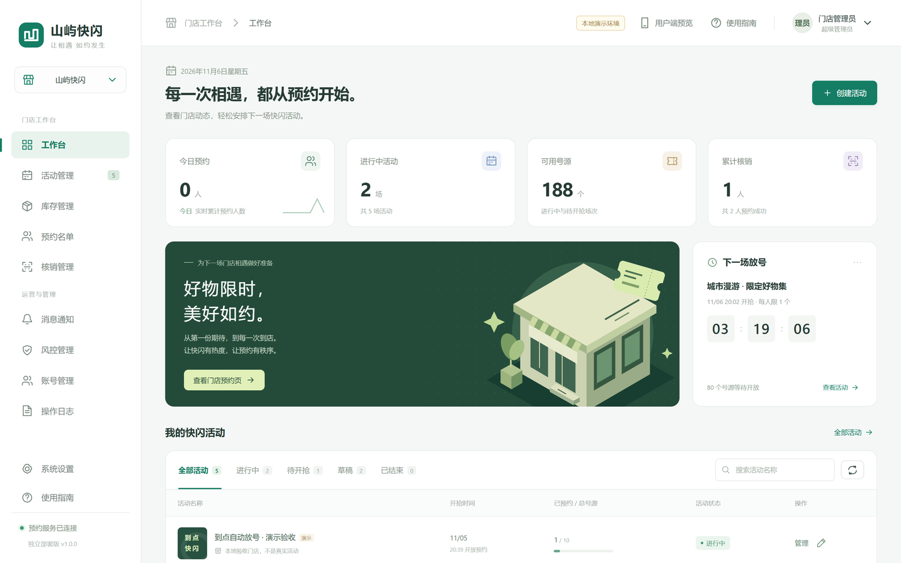
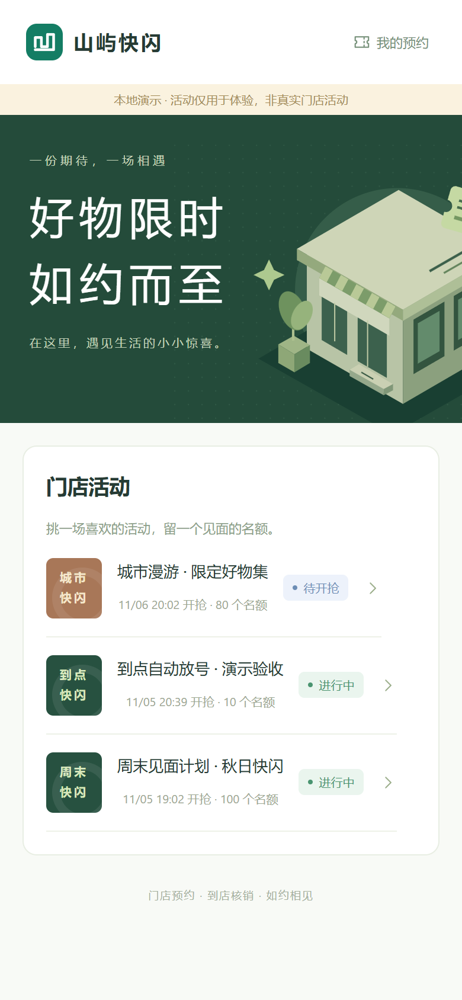

# 山屿快闪 · 门店预约系统

独立部署的门店快闪预约项目，包含运营后台、原生微信小程序、H5 预约验收页与 SQLite 预约服务。业务源码完整可编辑，无内置授权服务、加密源码、域名绑定或软件年费。详见 [源码交付说明](SOURCE-OWNERSHIP.md)。

[](https://github.com/baiyujing-rain/flash-reserve/actions/workflows/ci.yml)

公开仓库：[baiyujing-rain/flash-reserve](https://github.com/baiyujing-rain/flash-reserve)。[需求核对与待验项](docs/REQUIREMENTS-AUDIT.md) · [本地验收记录](VERIFICATION.md)。GitHub 托管源码和自动测试，正式预约服务需部署到自己的服务器。

当前状态：本地可运行交付版。真实微信登录、手机号授权、订阅消息送达、小程序审核和目标服务器验收需要门店自己的微信账号与部署环境；未冒充已上线系统。短信为可选扩展，当前未接入。**没有在线支付**，购买码是预约成功后的到店凭证。

## 界面

运营后台：今日预约、进行中活动、可用号源、累计核销四张卡片，下面是待开抢倒计时与活动列表。



用户端预约页（H5，手机尺寸）：三场演示活动，标注「本地演示」与各自状态。

<p align="center">
  
</p>

## 本地启动

需要 **Node.js 24+**，没有 npm 第三方依赖，无需运行 npm install。

```powershell
git clone https://github.com/baiyujing-rain/flash-reserve.git
cd flash-reserve
npm run demo
```

也可双击 `start-demo.cmd`。默认管理后台：<http://127.0.0.1:3210>；用户端：<http://127.0.0.1:3210/book>。端口被占用时：`powershell -File .\start-demo.ps1 -Port 3211`。

本地演示自动进入管理后台，三个示例活动均标注“演示”，预约统计初始为零。用户端勾选须知，点击预约，输入测试手机号即可走通预约与核销。演示模式仅允许监听本机；**正式部署必须关闭演示模式**。演示库 `data/demo.db` 与生产库 `data/production.db` 分离。

## 功能

| 模块 | 已实现行为 |
| --- | --- |
| 权限 | 超级管理员 / 运营 / 核销员 / 只读，接口校验权限；修改角色或密码使原会话失效；保护最后一个超级管理员 |
| 活动 | 名称、地点、须知、HTTPS banner、开抢/开始/结束时间、每人限约、草稿/发布/结束，按服务器时间派生待开抢/进行中/已结束 |
| 场次 | 一活动多场次，各自时段和号源；每人上限按整个活动累计 |
| 库存 | 实时余量、补放、扣减、锁定库存、暂停/恢复单场、一键暂停/恢复全部，调整原因留痕 |
| 预约 | 微信身份与验证手机号、唯一号码与 20 位购买码、请求幂等、活动全局限约 |
| 名单 | 手机号、昵称（默认微信用户）、openid、号码、购买码、状态；搜索、筛选、分页、CSV 导出（Excel 可打开） |
| 核销 | 输码或扫码枪输入、重复核销拦截、撤销原因、核销员/时间/场次/设备流水、导出 |
| 通知 | 订阅模板与字段配置、用户主动授权、放号前发送、发送状态和错误留痕 |
| 风控 | 黑名单、封禁/解封、会话失效、用户预约与后台登录限流阈值 |
| 系统 | 账号管理、关键操作审计、数据库快照下载、命令行备份/恢复 |

核销员不能撤销核销、改库存、查看系统账号或写配置；只读账号不能做业务写操作。订阅消息配置和完整备份仅超级管理员可修改/下载。操作日志在普通后台无删除接口。

## 自动放号：方案 A

1. 页面进入或回到前台，向服务端拉取活动状态、`server_now`、`release_at`。
2. 使用请求往返时间中点估算服务端时间，以单调时钟为倒计时基准，避免修改设备时钟影响倒计时。
3. 开抢前后各 10 秒，按 **300ms 请求起始间隔**检查状态；其他时间每 700ms 检查（同时覆盖临时补放、暂停、恢复）。每个页面最多一个在途请求，弱网不会堆积重复轮询。
4. 只有服务端返回场次 `has_stock=true`，按钮才变为“立即预约”；倒计时归零不直接认定有库存。
5. 页面隐藏时停轮询，回前台立即重新校准；网络断开禁用预约并提示自动重连。
6. 状态接口在各服务进程内合并 100ms 以内的相同活动查询，避免大量用户轮询重复读库；状态最多增加 100ms 可见延迟，预约提交仍以事务内实时校验为准。

“1 秒内”验收条件为前台页面、正常网络、服务可用且该场次仍有库存；断网、微信挂起后台或库存瞬间抢完无法承诺按钮必然显示可预约。最终需以真机和目标服务器测量为准。

## 防超卖与持久化

- SQLite WAL，外键、库存 CHECK 和多项唯一索引。
- `BEGIN IMMEDIATE` 事务中验证账号、时间、暂停、每人全活动限额，再执行条件更新 `total - sold - locked > 0`；号码递增、购买码、预约和审计一同提交。
- `(user_id, request_key)` 实现幂等；同一个 key 换场次会拒绝。客户端持久化未完成请求的 key，超时可原 key 重试。
- `(event_id, number)`、购买码、活动用户序号、活动手机号序号均有数据库唯一约束；同活动跨场次分配的号码也不重复。
- 预约业务采用 `synchronous=FULL`；限流计数使用独立连接的 NORMAL 同步级别。限流计数不是预约业务数据，掉电后允许丢失近期计数。
- 预约写入在独立工作线程完成，不占用 HTTP 状态查询线程。每进程写入排队上限 2000，满时显式返回重试提示；数据库条件更新支持多个进程共用本机同一 DB。
- **数据库必须位于本机持久化磁盘**，不把 WAL 数据库放在 NFS/SMB 或多个容器不同卷。水平扩展至多台服务器时需迁移到共享事务数据库，并重新压测。
- 核销与撤销核销不增加库存；撤销仅恢复购买码待核销状态。
- 写入线程完成初始化才报告健康，意外退出会拒绝在途请求并自动重启；客户端可使用原请求标识重试。每小时清理过期会话和过期一天的限流计数，业务记录保留。

## 验证

```powershell
npm run check
npm test
npm run test:load
node scripts/load-test.mjs --viewers
```

`test:load` 使用单独的 `artifacts/load-*.db`，两个独立 HTTP 进程、共享本机 SQLite、1000 个认证测试用户并发领取 100 个名额，断言 100 成功、900 售罄、无重复购买码/号码、20 次网络重试不额外扣库存。`--viewers` 还会增加 1000 个并行轮询客户端，结果另存 `artifacts/viewer-result.json`。独立观察客户端使用单独进程计时，避免压测生成器本身的 JSON 解码与大量回调阻塞计时。

同一压测中使用**同开抢时刻、独立且不被领取的观察活动**验证服务在预约负载下的状态接口自动切换；避免“100 个号已全部领完后仍要求观察到有库存”这种错误的测试条件。此指标使用与 H5 相同的轮询模块，不等同于微信真机端到端时延。完整实测记录位于 `artifacts/load-result.json`，并包含 Node 版本、时间、P50/P95 与环境限制。

## 正式部署

1. 复制 `.env.example` 为 `.env`，填写至少 12 位随机管理员密码、门店自己的微信 AppID/AppSecret、`PUBLIC_ORIGIN=https://实际域名`。不提交 `.env`，不在小程序源码中写 AppSecret。
2. `FLASH_DEMO=0`，使用全新的生产库。首次运行创建管理员；之后不会用环境变量覆盖已有账号密码。
3. 本机部署：`npm start`。服务默认仅监听本机，由自有 HTTPS 反向代理转发。需要 `HOST=0.0.0.0` 时仅在可信网络或代理后使用。
4. Docker 示例：`.env` 增加 `RESERVE_DOMAIN=实际域名`，将域名解析到服务器，开放 80/443，执行 `docker compose up -d --build`。后台 Cookie 在配置 HTTPS origin 后为 Secure。**镜像构建与生产容器启动已由 GitHub CI 验证；Caddy HTTPS 和域名仍需目标环境验收。**
5. 数据放在持久卷 `flash_data`；在门店系统中定期下载备份或运行 `scripts/backup.mjs`，备份另存其他磁盘/对象存储。按实际业务确定备份频率与保留期限。
6. 微信公众平台配置 HTTPS request 合法域名，按门店实际情况填写用户隐私保护指引、联系方式、数据保留期限与权限用途。

反向代理：直连时保持 `TRUST_PROXY=0`，服务忽略客户端自带的转发头。仅在应用端口不对外、流量都经过可信反向代理时设 `TRUST_PROXY=1`；提供的 Compose 已按这一拓扑配置。后台登录与小程序登录独立限流，小程序默认每 IP 每分钟 2000 次，避免同一门店 Wi-Fi 的 1000 个用户被合并误拦；可在系统设置调整。

GitHub 自动测试：每次 push、pull request 或手动触发，执行 Windows/Linux 源码及业务检查、1000 人抢号与 1000 页面轮询、Linux Docker 构建和生产模式启动验证。仅上传合成测试的 JSON 指标，不上传数据库、日志、`.env` 或凭据。共享 CI 环境的性能结果不等于门店生产网络 SLA。

无软件年费不代表零运营支出：域名、服务器、微信平台认证/接口及可选短信费用由对应平台计费；本源码没有授权续费机制。预算 3 万元内建议先采用当前单店版本，短信、在线支付、多门店与多机集群另行评估。

## 导入原生微信小程序

用微信开发者工具导入 `miniprogram/`：

- 将 `project.config.json` 的 `appid` 改为门店自己的小程序 AppID。
- 在 `config.js` 设置自有 HTTPS 域名，`demo:false`。正式微信用户的 `openid` 和手机号均通过服务端微信接口取得，客户端不能任意指定。
- 在服务端 `.env` 配置对应 AppID 与 AppSecret，重新启动服务。
- 消息通知页面配置模板 ID、`thing/time` 字段名和提醒提前量；模板字段必须匹配门店在微信公众平台实际申请的模板。
- 小程序内用户点击订阅按钮才调用 `wx.requestSubscribeMessage`；后台每 5 秒检查待发任务，窗口为开抢前设定分钟数。拒绝订阅不影响预约。发送失败记录原因；不做无限重试，服务重启时在途消息保留“送达待确认”状态，避免重复推送或覆盖另一服务进程正在发送的任务。
- 本地开发可把 baseUrl 改为本机地址、`demo:true` 并连接本地演示服务，仅供开发者工具体验。不要提交演示配置作为正式版。

已提供原生代码和 JS 语法检查；**尚未使用真实 AppID 在微信开发者工具编译和真机验证**。原生页昵称默认“微信用户”，不擅自获取用户微信昵称；若需展示真实昵称，可按微信能力规范增加用户主动填写。

## 备份与恢复

后台“系统设置 → 下载完整数据库备份”生成一致性快照，不直接复制正在使用的 WAL 主文件。

命令行也可备份：

```powershell
node --env-file-if-exists=.env scripts/backup.mjs data/backups/manual.sqlite
```

恢复步骤：

1. 停止所有使用此数据库的服务/工作线程。
2. 执行 `node scripts/restore.mjs data/backups/manual.sqlite data/production.db --service-stopped`。
3. 工具检查完整性、版本、外键和管理员；恢复前保留原库快照，恢复后注销所有旧会话。
4. 重新启动服务，管理员重新登录，检查活动与预约数据后再恢复运营。

备份包含敏感业务数据，应由门店保管并控制访问。备份恢复行为会回到备份时刻，请保留核销对账记录。

## 目录

```text
public/          管理后台与可交互 H5 预约页
miniprogram/     原生微信小程序完整工程
lib/             数据模型、HTTP 接口、微信适配、预约工作线程
scripts/         检查、压测、备份、恢复
tests/           业务、权限、导出与两套客户端轮询测试
deploy/          自部署 HTTPS 代理示例
data/            运行数据库（忽略提交）
artifacts/       压测数据、实测结果和截图（忽略提交）
```
